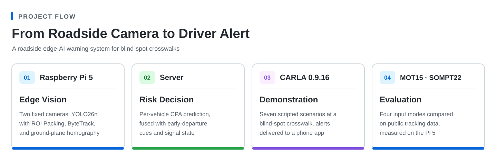
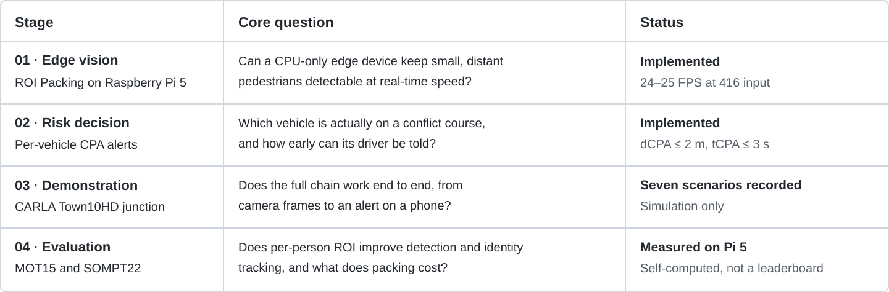

<h1 align="center">BlindGuard-X</h1>

<p align="center">
  <strong>Two seconds before the crosswalk.</strong><br>
  A roadside edge-AI system that warns drivers before a pedestrian conflict at blind-spot crosswalks.
</p>

<p align="center">
  <a href="docs/system-flow.md"><b>System Flow</b></a> &nbsp;·&nbsp;
  <a href="docs/vision-method.md"><b>Vision Method</b></a> &nbsp;·&nbsp;
  <a href="docs/evaluation.md"><b>Evaluation</b></a> &nbsp;·&nbsp;
  <a href="docs/related-work.md"><b>Related Work</b></a> &nbsp;·&nbsp;
  <a href="docs/setup.md"><b>Run It</b></a>
</p>

<p align="center">
  
  
  
  
</p>

---

## Overview

This repository contains the working implementation of BlindGuard-X: two fixed roadside cameras and a Raspberry Pi 5 observe a crosswalk, a server predicts conflicts for each approaching vehicle, and **only the vehicle on a conflict course** receives an alert on the driver's phone.

> **Can a CPU-only edge device see a pedestrian that the driver cannot—and tell the right driver early enough to matter?**

## Project Flow

<p align="center">
  
</p>

<p align="center">
  
</p>

### From camera to alert

The starting point was a blind-spot problem: a parked truck hides a pedestrian who is about to step into the road. A roadside camera can see what the driver cannot, but a small edge device must shrink each frame to run a detector in real time, and distant pedestrians shrink with it. This raised the central vision question: **can the detector be given more pixels per person without being given a larger input?**

The approach explored here is ROI Packing—cropping only the regions where people are likely to be and packing them into a single 416×416 canvas for one inference. The rest of the system turns those detections into ground-plane positions, predicts the closest point of approach for each vehicle, and sends a staged alert to the driver who needs it.

## Project Focus

- **Edge vision:** Optical Flow + Track Memory → Adaptive ROI → ROI Packing (416×416) → YOLO26n-NCNN → ByteTrack → Homography
- **Early cue:** A second camera watches the waiting zone (MOG2 + Sparse LK) and scores early-departure motion
- **Risk decision:** Per-vehicle CPA under a constant-velocity assumption, fused with the early cue and pedestrian-signal state
- **Selective alerting:** Caution / Warning / Danger delivered over WebSocket to the conflicting vehicle only
- **Evaluation:** Four input strategies compared on public tracking data, with accuracy and per-frame processing time measured on the Pi 5

## Evaluation Summary

Same detector, tracker and settings; only the image region given to the detector changes. Raspberry Pi 5, YOLO26n-NCNN at 416 input, ByteTrack. Metrics are **self-computed** on training sequences with public ground truth.

**MOT15** — all six static-camera sequences (2,315 frames)

| Input strategy | MOTA | IDF1 | Recall | Precision | FPS |
|---|---|---|---|---|---|
| FULL | 52.4 | 52.9 | 62.6 | **86.9** | **30.6** |
| ADAPTIVE | 54.2 | 55.4 | 65.3 | 86.3 | 25.3 |
| OURS (per-ROI inference) | 53.1 | **59.8** | **72.9** | 79.3 | 11.5 |
| OURS_PACKED | **56.0** | 59.5 | 67.4 | 86.4 | 25.2 |

**SOMPT22** — nine training sequences, first 10 s of each (2,700 frames)

| Input strategy | MOTA | IDF1 | Recall | Precision | FPS |
|---|---|---|---|---|---|
| FULL | 18.0 | 27.9 | 19.5 | **93.6** | **30.2** |
| ADAPTIVE | 19.6 | 30.0 | 21.4 | 92.9 | 24.8 |
| OURS (per-ROI inference) | **29.3** | **42.6** | **33.0** | 90.6 | 8.7 |
| OURS_PACKED | 23.5 | 35.1 | 26.1 | 91.9 | 24.3 |

**Observed direction:** Per-person ROI raised Recall and IDF1 over full-frame input on both datasets. Packing kept part of that gain at 2.2–2.8× the speed of per-ROI inference. **Full-frame input remained the fastest**; what this approach buys is accuracy, not speed.

Explore the **[system flow](docs/system-flow.md)**, **[vision method](docs/vision-method.md)**, and **[full evaluation with limitations](docs/evaluation.md)** for the complete account.

## Repository Layout

| Path | Contents |
|---|---|
| `bgx/` | Core library: Cam1/Cam2 pipelines, ByteTrack, homography, GPS-to-ground mapping, CPA and fusion |
| `pi/` | Raspberry Pi 5 edge program and setup, check and calibration scripts |
| `server/` | Server (Starlette) and web views: control, monitor, studio, HUD |
| `simdemo/` | CARLA 0.9.16 demonstration; virtual camera frames are streamed to a real Pi |
| `bench/` | Public-dataset evaluation scripts (MOT15, SOMPT22) |
| `app_patch/` | Changes to the driver phone app (Flutter); the full app is not included |
| `tests/`, `tools/`, `shoot/`, `analysis/` | Tests with a fake CARLA, deployment helpers, capture and log analysis |
| `docs/`, `assets/` | Project documentation and figures |

## Run It

A laptop is enough to watch the full decision chain in about five minutes—no CARLA, no Pi:

```bash
pip install starlette "uvicorn[standard]" numpy pandas opencv-python scipy websockets
python3 tests/test_core.py
FAKE_RT=0.6 PYTHONPATH=tests/fakecarla python3 tests/run_fake_demo.py case1_blind_spot
# → A: caution → warning → danger, stops 2 m before the pedestrian · B: no alert
```

The **[setup guide](docs/setup.md)** covers three levels: laptop only, CARLA + Raspberry Pi 5, and real cameras.

> [!NOTE]
> This is a **working prototype, not a validated safety system**. It has been exercised in simulation, in a limited webcam test and on public datasets—never on a public road. Model weights, datasets, recordings and real-world footage are excluded, and network addresses are placeholders to be replaced with your own. Reported numbers are self-computed and are not leaderboard results; numbers from different datasets should not be compared directly.

<details>
<summary><strong>한국어 요약</strong></summary>

사각지대 횡단보도에서 보행자 충돌 위험을 운전자에게 미리 알리는 도로변 엣지 AI 시스템. 고정 카메라 2대와 Raspberry Pi 5가 보행자를 검출·추적하고(Optical Flow + Track Memory로 ROI를 만들어 416×416 한 장에 Packing → YOLO26n-NCNN → ByteTrack), 서버가 차량별 CPA로 위험을 판정해 해당 차량의 폰 앱에만 주의·경고·긴급을 보낸다. CARLA 시연 7가지 상황과 공개 데이터셋 2종(MOT15, SOMPT22) 평가까지 진행했으며, 실제 도로 검증은 하지 않았다. 코드 주석과 일부 실행 문서는 한국어다.

</details>
