# BlindGuard-X

[](docs/vision-method.md) [](docs/vision-method.md) [](docs/evaluation.md) [](docs/evaluation.md#limitations)

#### Roadside edge AI that warns drivers about pedestrians they can't see.

<p align="center">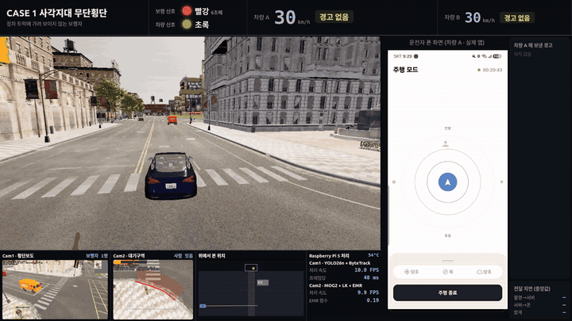</p>

> *Two seconds before the crosswalk.* A parked truck hides a pedestrian. Two roadside cameras and a Raspberry Pi 5 see them first; the server predicts the conflict and the driver's phone goes from **caution** to **warning** to **danger** before the car reaches the crosswalk. (CARLA demonstration, scenario `case1_blind_spot`; on-screen text is Korean.)

## Demo Links

<p align="center">
  <a href="#visualization-results-in-carla"><b>Demo videos (7 scenarios)</b></a> &nbsp;·&nbsp;
  <a href="#demo"><b>5-minute quick start</b></a> &nbsp;·&nbsp;
  <a href="docs/evaluation.md"><b>Evaluation: MOT15 · SOMPT22</b></a> &nbsp;·&nbsp;
  <a href="docs/related-work.md"><b>Related work</b></a>
</p>

## Abstract

Drivers cannot react to a pedestrian they cannot see. BlindGuard-X watches the crosswalk from the roadside with two cameras and a Raspberry Pi 5, and alerts **only the vehicle on a conflict course**. ROI Packing keeps distant pedestrians detectable at a 416×416 input. Tested in CARLA and on public datasets—not on public roads.

<p align="center">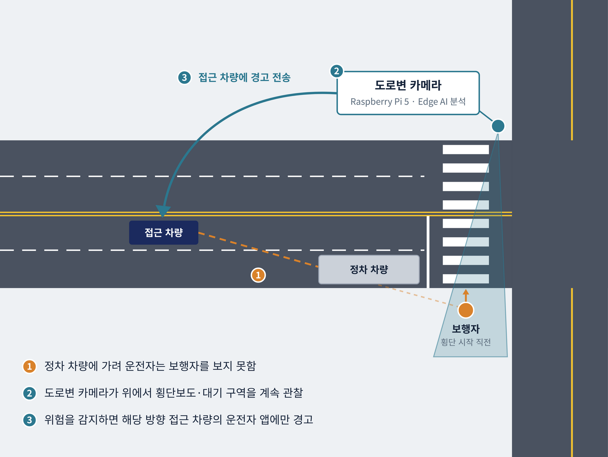</p>

> Concept (poster figure 1; labels in Korean). ① A parked vehicle hides the pedestrian from the driver. ② A roadside camera keeps watching the crosswalk and the waiting zone. ③ When a risk is detected, only the approaching vehicle on that side is alerted.

## Pipeline

<p align="center">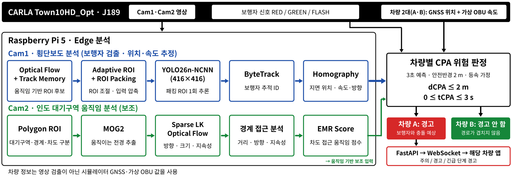</p>

> System architecture (poster figure 2; labels in Korean). CARLA supplies the two camera streams, pedestrian-signal state, and each vehicle's GNSS position and virtual OBU speed. The Raspberry Pi 5 analyses Cam1 (blue) and Cam2 (green); the server makes the per-vehicle CPA decision and sends caution / warning / danger to the app of the vehicle concerned.

<p align="center"></p>

**Cam1 (crosswalk):** Optical Flow + Track Memory → Adaptive ROI → ROI Packing (416×416) → YOLO26n-NCNN → ByteTrack → Homography<br>
**Cam2 (waiting zone):** Polygon ROI → MOG2 → Sparse LK → boundary approach → EMR score<br>
**Server:** per-vehicle CPA (dCPA ≤ 2 m, 0 ≤ tCPA ≤ 3 s, constant velocity) + Cam2 early cue + signal state → caution / warning / danger

Details: [system flow](docs/system-flow.md) · [vision method](docs/vision-method.md)

<p align="center">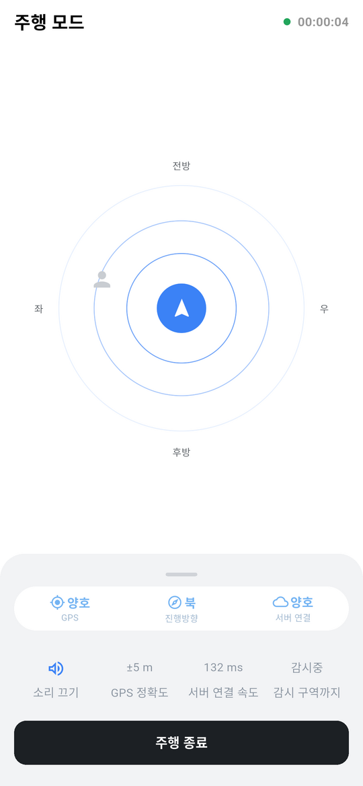&nbsp;&nbsp;&nbsp;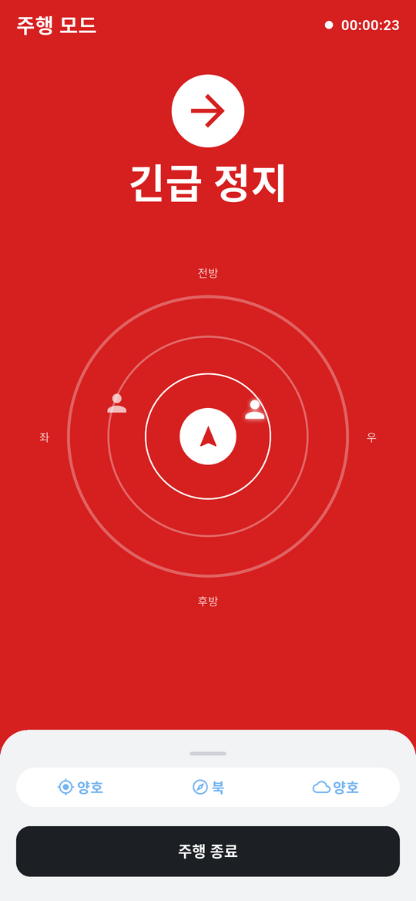</p>

> Driver app: normal driving (left) and a danger alert (right). The radar shows where the pedestrian is relative to the vehicle's heading.

<p align="center">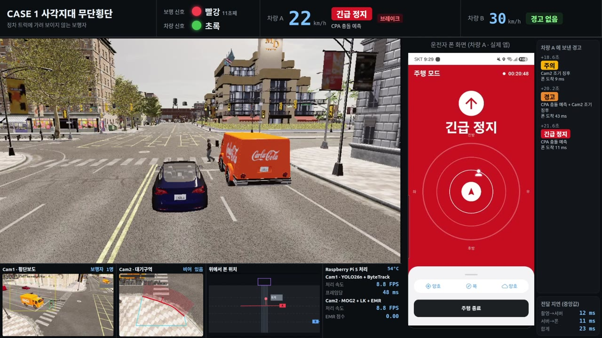</p>

> Recording layout. Top: scenario, signals, and the alert state of vehicles A and B. Centre: CARLA view and the driver's real phone screen. Bottom: Cam1 and Cam2 as analysed on the Raspberry Pi 5, a top-down map, Pi processing rate, and delivery latency.

## Benchmark Performance

Same detector, tracker and settings; only the image region given to the detector changes. Raspberry Pi 5, YOLO26n-NCNN at 416 input, ByteTrack. Metrics are self-computed on training sequences with public ground truth—**not leaderboard results**.

### Results on MOT15 (six static-camera sequences, 2,315 frames)

<p align="center">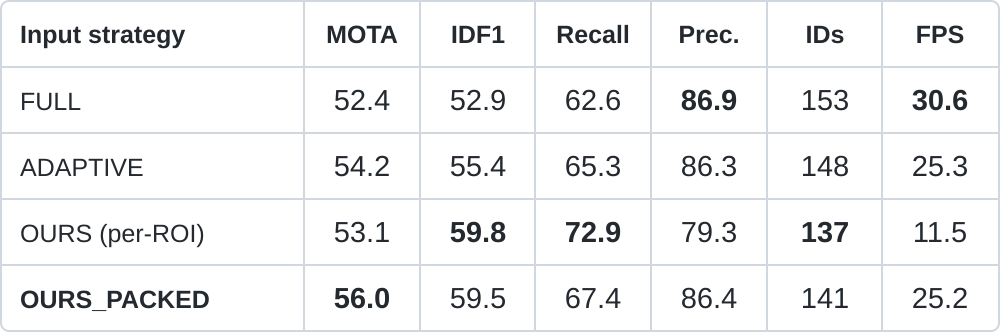</p>

### Results on SOMPT22 (nine training sequences, first 10 s each, 2,700 frames)

<p align="center">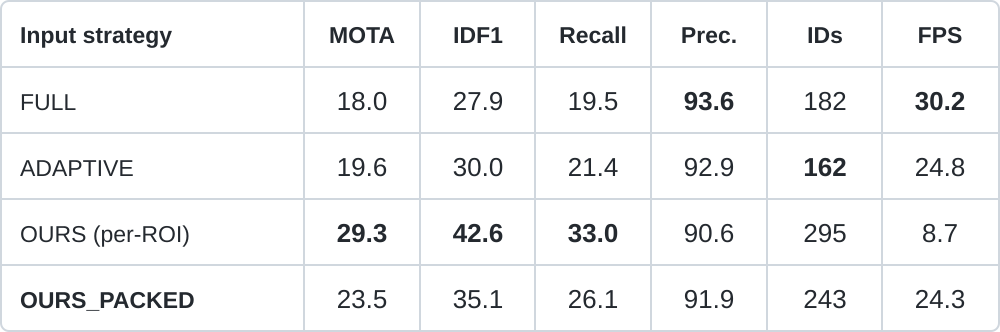</p>

Bold marks the best value in each column. Per-person ROI raised Recall and IDF1 over full-frame input on both datasets. Packing kept part of that gain at 2.2–2.8× the speed of per-ROI inference. **Full-frame input remained the fastest.** Per-sequence tables are in [docs/evaluation.md](docs/evaluation.md).

### Visualization results in CARLA

Each clip shows the moment of decision. Click a title for the full video.

<table align="center">
  <tr>
    <td align="center" valign="top" width="50%">
      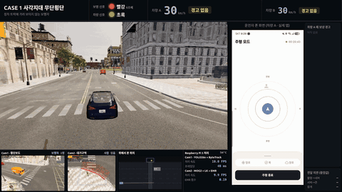<br>
      <a href="assets/videos/case1_blind_spot.mp4"><b>CASE 1 · Blind spot</b></a><br>
      Caution → warning → danger;<br>stops 2 m before the pedestrian
    </td>
    <td align="center" valign="top" width="50%">
      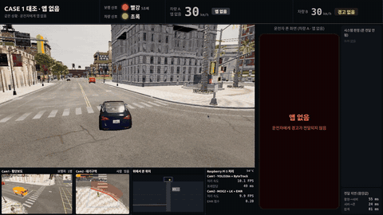<br>
      <a href="assets/videos/case1_no_app.mp4"><b>CASE 1 control · No app</b></a><br>
      Same scene without the alert:<br>collision
    </td>
  </tr>
</table>

<table align="center">
  <tr>
    <td align="center" valign="top" width="50%">
      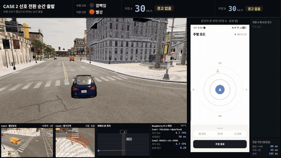<br>
      <a href="assets/videos/case2_signal_change.mp4"><b>CASE 2 · Signal change</b></a><br>
      Pedestrian runs just after red;<br>warning, gradual stop
    </td>
    <td align="center" valign="top" width="50%">
      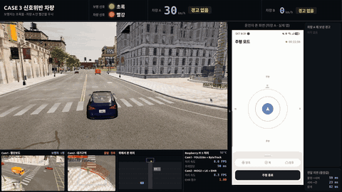<br>
      <a href="assets/videos/case3_red_light.mp4"><b>CASE 3 · Red-light runner</b></a><br>
      Only the vehicle running the light<br>is alerted
    </td>
  </tr>
</table>

<table align="center">
  <tr>
    <td align="center" valign="top" width="50%">
      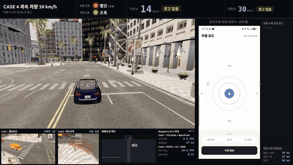<br>
      <a href="assets/videos/case4_speeding.mp4"><b>CASE 4 · Speeding</b></a><br>
      50 km/h approach;<br>alerted earlier, stops in time
    </td>
    <td align="center" valign="top" width="50%">
      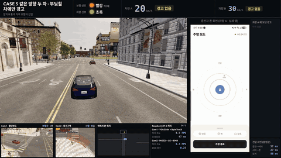<br>
      <a href="assets/videos/case5_selective.mp4"><b>CASE 5 · Selective alert</b></a><br>
      Two vehicles in adjacent lanes;<br>only the one still in conflict is alerted
    </td>
  </tr>
</table>

<table align="center">
  <tr>
    <td align="center" valign="top" width="50%">
      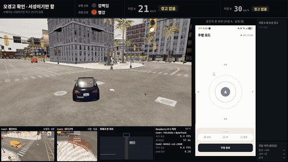<br>
      <a href="assets/videos/case0_wait_only.mp4"><b>CASE 0 control · Loitering</b></a><br>
      Pedestrian only waits;<br>no false alert
    </td>
    <td align="center" valign="top" width="50%"></td>
  </tr>
</table>

In these recordings the camera frames are analysed on a real Raspberry Pi 5 and the alert is shown on a real phone. Vehicle position and speed, signals, and the scripted motion come from the simulator.

## Installation

### 1. Laptop only (no CARLA, no Pi)

```shell
git clone https://github.com/hongzzang-Lab/BlindGuard-X.git
cd BlindGuard-X
pip3 install starlette "uvicorn[standard]" numpy pandas opencv-python scipy websockets
```

### 2. Raspberry Pi 5

```shell
bash tools/deploy_pi.sh <pi-user>@<pi-ip>     # on the laptop: copies the code to ~/realtest on the Pi
cd ~/realtest && bash pi/setup_pi.sh          # on the Pi: venv, ultralytics, ncnn, YOLO26n → NCNN 416
```

Addresses in this repository are placeholders; use your own. CARLA 0.9.16 is needed for the full simulation demo.

## Demo

Watch the full decision chain on a laptop with a fake CARLA and the real server code:

```shell
python3 tests/test_core.py
FAKE_RT=0.6 PYTHONPATH=tests/fakecarla python3 tests/run_fake_demo.py case1_blind_spot
# → vehicle A: caution → warning → danger, stops 2 m before the pedestrian · vehicle B: no alert
```

With CARLA and a Pi:

```shell
bash simdemo/start_sim_server.sh                                   # laptop
cd ~/realtest && bash simdemo/run_pi_sim.sh <laptop-ip>            # Pi
bash simdemo/run_demo.sh --pi <pi-ip> --variant case1_blind_spot --takes 1 --view chase --no-check   # laptop
```

Scenarios: `case1_blind_spot`, `case2_signal_change`, `case3_red_light`, `case4_speeding`, `case5_selective`, `case1_no_app`, `wait_only`. Step-by-step instructions are in the [setup guide](docs/setup.md).

## Evaluation

```shell
bash bench/send_to_pi.sh <pi-user>@<pi-ip>                         # laptop
cd ~/realtest && bash bench/run_on_pi.sh                           # Pi: MOT15 (downloaded by the script)
cd ~/realtest && bash bench/run_on_pi.sh --bench sompt22           # Pi: SOMPT22 (obtain the data yourself)
```

Datasets and model weights are not included. See [bench/README.md](bench/README.md) (Korean).

## Acknowledgement

This project builds on [Ultralytics YOLO](https://github.com/ultralytics/ultralytics), [NCNN](https://github.com/Tencent/ncnn), the [ByteTrack](https://github.com/ifzhang/ByteTrack) association method, and the [CARLA](https://carla.org/) simulator, and is evaluated on [MOT15](https://motchallenge.net/) and [SOMPT22](https://sompt22.github.io/). ROI packing was introduced by earlier work such as [Pack and Detect](https://arxiv.org/abs/1809.01701); see [related work](docs/related-work.md). The structure of this README follows common practice in open-source tracking repositories such as ByteTrack and OC-SORT.

<details>
<summary><strong>한국어 요약</strong></summary>

사각지대 횡단보도에서 보행자 충돌 위험을 운전자에게 미리 알리는 도로변 엣지 AI 시스템. 고정 카메라 2대와 Raspberry Pi 5가 보행자를 검출·추적하고(Optical Flow + Track Memory로 ROI를 만들어 416×416 한 장에 Packing → YOLO26n-NCNN → ByteTrack), 서버가 차량별 CPA로 위험을 판정해 해당 차량의 폰 앱에만 주의·경고·긴급을 보낸다. CARLA 시연 7가지 상황과 공개 데이터셋 2종(MOT15, SOMPT22) 평가까지 진행했으며, 실제 도로 검증은 하지 않았다. 코드 주석과 일부 실행 문서, 영상 속 글자는 한국어다.

</details>
