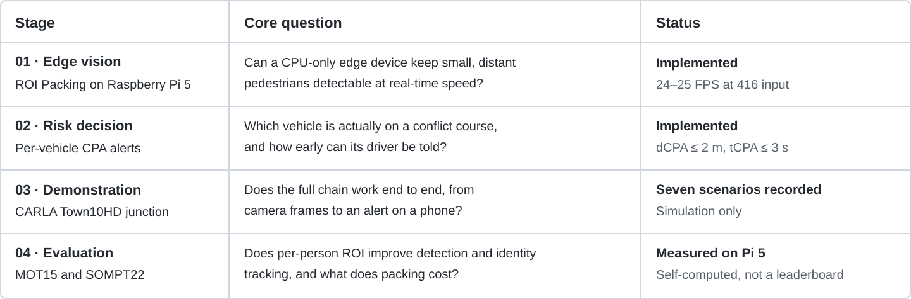

# System Flow

> From two roadside cameras to a staged alert on one driver's phone.

<p align="center"></p>

This page follows a single observation through the system. It describes what the implementation does, **not** a claim that the system has been validated on public roads.

```
 [Cam1 crosswalk] ───┐
                     ├─ Raspberry Pi 5 (pi/edge.py)
 [Cam2 waiting zone] ┘    Cam1: Optical Flow + Track Memory → Adaptive ROI → ROI Packing (416×416)
                                → YOLO26n-NCNN → ByteTrack → Homography (ground metres)
                          Cam2: Polygon ROI → MOG2 → Sparse LK → boundary approach → EMR score
                             │  pedestrian position and velocity, early-departure cue
                             ▼  WebSocket
                    Server (server/exp_server.py)
                          vehicle position and speed (phone GPS, or CARLA) → per-vehicle CPA
                          + Cam2 early cue + pedestrian-signal state
                             │  caution / warning / danger
                             ▼  WebSocket
                    Phone app of the conflicting vehicle
```

## 01 — Edge vision (Raspberry Pi 5)

**Question:** Can a CPU-only device detect and track pedestrians in real time, including distant ones?

Cam1 looks at the crosswalk. Each frame goes through motion and track-based region selection, ROI Packing, one YOLO26n-NCNN inference at 416×416, and ByteTrack. Foot points are mapped to ground-plane metres with a homography, and velocity is estimated from recent positions. Cam1 and Cam2 run as separate processes on the same Pi, and each keeps only its newest frame so that processing never falls behind the camera.

[Vision method in detail](vision-method.md)

**Next question:** Detection starts once a pedestrian is visible in the crosswalk view. Can intent be noticed earlier?

## 02 — Early cue (Cam2)

**Question:** Is there a usable signal before the pedestrian leaves the kerb?

Cam2 watches the waiting zone. Foreground from MOG2 and sparse Lucas–Kanade flow are combined into an Early Motion Risk (EMR) score from three terms: proximity to the kerb line, motion toward the road, and persistence. The kerb boundary may be a polyline, so curved kerbs are supported.

**Status:** The weights and threshold (0.4 / 0.4 / 0.2, threshold 0.6) were set by the team, not fitted to field data. The cue worked in simulation; **it did not trigger in our real-camera test**.

**Next question:** Which vehicle, if any, is this pedestrian in conflict with?

## 03 — Risk decision (server)

**Question:** Which vehicle is on a conflict course, and how early can its driver be told?

For each vehicle the server computes the closest point of approach (CPA) with the pedestrian under a constant-velocity assumption (`bgx/risk.py`, `bgx/fusion.py`).

| Level | Condition |
|---|---|
| Caution | Cam2 EMR ≥ 0.6 (sustained) and the vehicle will reach the crosswalk within 5 s in the lane nearest the waiting zone |
| Warning | Cam1 CPA: dCPA ≤ 2 m and 0 ≤ tCPA ≤ 3 s — or a Caution during a signal transition (flashing, or within 3 s of red) |
| Danger | CPA condition with tCPA ≤ 1.5 s |

A level is held for one second to avoid flicker and is sent only when it changes. A vehicle that is not on a conflict course receives nothing, even when it is in the same scene.

Vehicle position comes from the phone's GPS (mapped to the ground frame through a surveyed anchor point, then map-matched and Kalman-filtered) or, in simulation, from CARLA's GNSS and a virtual OBU speed.

**Next question:** Does the whole chain hold together in a concrete scene?

## 04 — Demonstration (CARLA)

**Question:** Does the full chain work end to end, from camera frames to an alert on a phone?

`simdemo/carla_demo.py` recreates a blind-spot crosswalk at a Town10HD_Opt junction. Two virtual cameras are streamed over TCP to a **real Raspberry Pi 5**, which runs the same edge program used with physical webcams. The server decides from the Pi's actual perception plus the simulated vehicle state; ground truth is logged only for later checking and is never used for the decision.

| Scenario | Situation | Expected for vehicle A |
|---|---|---|
| `case1_blind_spot` | Pedestrian steps out from behind a parked truck | Caution → Warning → Danger, hard stop |
| `case2_signal_change` | Pedestrian runs just after the signal turns red | Warning, gradual stop |
| `case3_red_light` | Vehicle runs a red light during a normal crossing | Caution → Warning, stop |
| `case4_speeding` | Vehicle approaches at 50 km/h | Caution → Warning, stop |
| `case5_selective` | Two vehicles in adjacent lanes; only one is in conflict | Alert to the conflicting vehicle only |
| `case1_no_app` | Control: same as case 1 without the app | Collision |
| `wait_only` | Control: pedestrian only loiters | No alert |

**What is real, simulated and scripted**

- **Real:** camera frames analysed on a Pi 5, the server's decision, delivery to and display on a phone app.
- **Simulated:** vehicle position (CARLA GNSS) and speed (virtual OBU), pedestrian-signal state.
- **Scripted:** pedestrian and vehicle schedules, and the driver's reaction to an alert (0.3 s reaction, then braking).

A safety stop prevents a staged collision when an alert is missing or late; when it is used, the take is logged as a failure rather than a success.

**Status:** Seven scenarios recorded in simulation. No road trial.

---

[Back to README](../README.md) · [Vision method](vision-method.md) · [Evaluation](evaluation.md)
