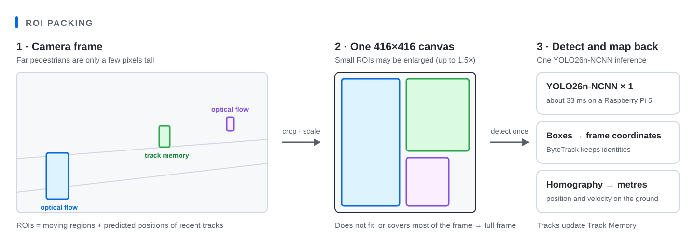

# Vision Method — ROI Packing on a Raspberry Pi 5

This page documents how Cam1 selects and packs regions before detection (`bgx/cam1_pipeline.py`). The individual ideas are not new; see [related work](related-work.md).

## Why

The Raspberry Pi 5 has no GPU, so input size is speed. At a 416×416 input, one YOLO26n-NCNN inference takes about 33 ms on the Pi. A larger input costs proportionally more pixels (640×640 has roughly 2.4× as many), and a smaller one makes distant pedestrians too small to detect.

**Question:** Can the detector see each person at a higher resolution without a larger input?

## How regions are chosen

Regions of interest come from two signals that are merged every frame.

| Signal | What it catches |
|---|---|
| **Optical Flow** — Farneback flow on a frame reduced to 160 px wide; pixels moving more than 0.8 px/frame for two consecutive frames (defaults) are grouped into blobs | People entering the view, people who are moving |
| **Track Memory** — the predicted position of every track seen within the last second (last box + recent velocity × elapsed time) | People already tracked who stopped, or whose detection dropped for a moment |

Each candidate box is expanded by a 30 % margin with a minimum size, and overlapping boxes are merged until none overlap. The remaining boxes are the ROIs.

- **A pedestrian who has never moved and was never tracked is invisible to both signals.** A periodic full-frame pass every N frames covers this case; once detected, the person is kept by Track Memory.
- **When the merged ROIs cover most of the frame, or do not fit in one canvas, that frame is processed full-frame.**

## Packing

The ROIs are scaled and placed into a single 416×416 canvas, the detector runs once, and detections are mapped back to original coordinates. Small, distant ROIs may be enlarged (up to 1.5×) so that a far pedestrian occupies more detector pixels than in a uniformly shrunk frame.

## Modes

The pipeline exposes four input strategies so they can be compared under identical settings.

| Mode | Name in results | What the detector sees |
|---|---|---|
| `full` | FULL | The whole frame resized to 416, one inference (baseline) |
| `adaptive` | ADAPTIVE | One large ROI enclosing all motion and tracks, one inference |
| `crops` | OURS (per-ROI inference) | Each ROI cropped separately, one inference per ROI |
| `packed` | OURS_PACKED | All ROIs packed into one 416×416 canvas, one inference |

## What was and was not established

- **Per-person ROI finds more people.** Recall and IDF1 rose over full-frame input on both evaluation datasets.
- **Packing recovers part of that gain in a single inference**, at 2.2–2.8× the speed of per-ROI inference.
- **Packing is not faster than plain full-frame detection.** Selecting and packing regions adds about 7–8 ms per frame.
- **Crowded scenes defeat packing.** With many people the ROIs must be shrunk to fit, or the frame falls back to full-frame.
- **A full-frame detector at a larger input (for example 640) was not measured.** Whether ROI Packing reaches a given accuracy more cheaply than simply enlarging the input remains an open question.
- **416 was chosen because it runs in real time on the Pi 5**, not because it was shown to be optimal; other input sizes were not compared.

[Back to README](../README.md) · [Evaluation](evaluation.md) · [Related work](related-work.md)
